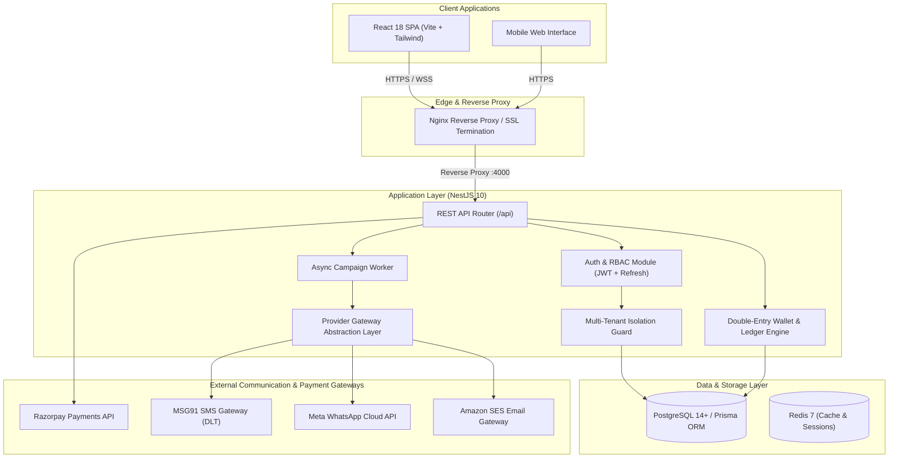
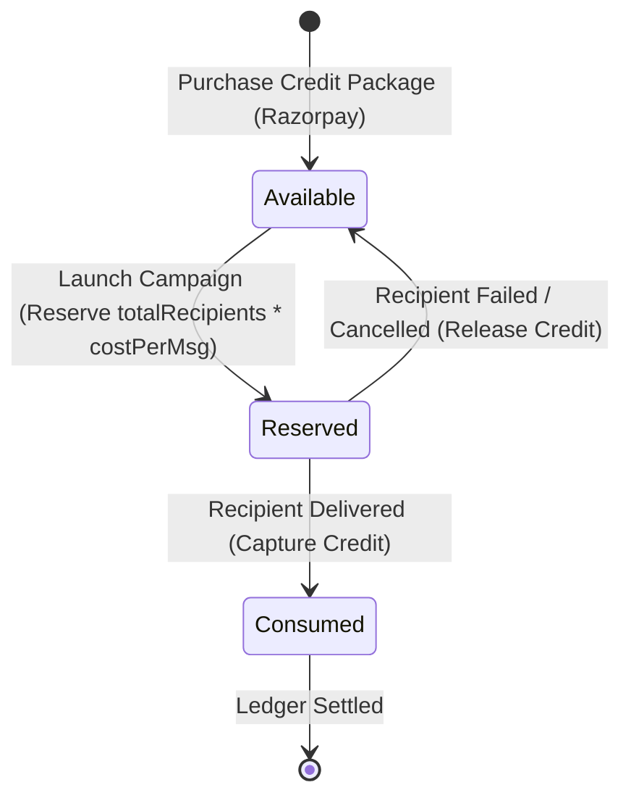

# BAASH GROWTH — System Architecture & Design Documentation

## 1. Architectural Overview

BAASH GROWTH is designed as a secure, scalable, multi-tenant communication CRM and marketing platform integrated into the BAASH business ecosystem. It enables multiple businesses/vendors registered with BAASH to manage their customer database, purchase prepaid communication credits, and launch targeted marketing campaigns across SMS, WhatsApp, and Email.



---

## 2. Multi-Tenancy Isolation Model

### 2.1 Shared-Database, Shared-Schema Architecture
BAASH GROWTH utilizes a shared-database, shared-schema multi-tenant design with tenant discriminators (`vendor_id`).
- All vendor data entities (`Customer`, `CustomerTag`, `CustomerSegment`, `CommunicationTemplate`, `Campaign`, `VendorWallet`, `WalletTransaction`, `Payment`) contain a mandatory `vendor_id UUID` column referencing `vendors(id) ON DELETE CASCADE`.
- Platform administrators (`SUPER_ADMIN`) belong to `BAASH` platform authority with `vendor_id = NULL`.

### 2.2 Strict In-Flight Tenant Extraction
- Tenant context is **never accepted from query parameters or request bodies**.
- The JWT access token contains `sub` (User ID), `role`, `vendorId`, and granular permissions.
- NestJS `TenantGuard` extracts `user.vendorId` directly from the authenticated session context.
- The `@CurrentTenant()` parameter decorator injects the verified `vendorId` directly into controllers.
- Any attempt by Vendor A to request, modify, or delete a resource belonging to Vendor B results in an immediate `404 Not Found` or `403 Forbidden` response.

---

## 3. Financial Ledger & Wallet Architecture

BAASH GROWTH implements a prepaid double-entry ledger model guaranteeing financial integrity and auditability.



### 3.1 Separate Wallets per Channel
Every vendor workspace maintains three isolated wallets:
1. **SMS Wallet**: Debited per DLT-approved SMS segment.
2. **WhatsApp Wallet**: Debited per WhatsApp Business template submission.
3. **Email Wallet**: Debited per Amazon SES dispatch.

### 3.2 Double-Entry Ledger Transactions
Every credit mutation generates an immutable record in `wallet_transactions`:
- `CREDIT`: Account top-up via completed Razorpay payment or admin manual grant.
- `DEBIT`: Actual consumption captured after campaign recipient processing.
- `REVERSAL`: Restitution of previously debited credits upon delivery failure or refund.

### 3.3 Reconciliation Invariant
The platform includes an automated reconciliation engine (`reconcileWallets`) enforcing the invariant:
$$\text{Calculated Balance} = \sum \text{Credits} - \sum \text{Debits}$$
$$\text{Discrepancy} = \text{Stored Balance} - \text{Calculated Balance}$$
Active campaigns in `QUEUED`, `PROCESSING`, or `SCHEDULED` status are continuously validated against stored `reserved` credits.

---

## 4. Communication Provider Gateway Abstraction

Providers are abstracted behind clean TypeScript interfaces, decoupling campaign business logic from third-party vendor APIs:

```typescript
export interface ISmsProvider {
  sendSms(to: string, message: string, dltTemplateId?: string): Promise<ProviderSendResult>;
}

export interface IWhatsAppProvider {
  sendTemplate(to: string, templateName: string, languageCode: string, components?: any[]): Promise<ProviderSendResult>;
}

export interface IEmailProvider {
  sendEmail(to: string, subject: string, htmlBody: string, textBody?: string): Promise<ProviderSendResult>;
}
```

### 4.1 Fail-Safe Fallbacks
- If provider credentials are missing or inactive, the system automatically falls back to the in-memory **Simulation Gateway** with detailed diagnostics logged to `provider_messages`.
- Real provider integrations strictly run through backend services; API keys and secrets are never exposed to the browser.
- Delivery status updates are processed asynchronously via webhook receivers (`/api/webhooks/*`) with signature verification and idempotent payload logging.

---

## 5. Security Architecture

1. **Password Hashing**: Bcrypt with 12 salt rounds.
2. **Session Architecture**: Short-lived (15 min) JWT Access Tokens paired with secure, HTTP-only, SameSite Refresh Cookies (7 days).
3. **XSS Prevention**: User-supplied email template variables (`{{firstName}}`, etc.) are HTML-escaped prior to rendering and dispatch.
4. **Credential Masking**: All provider credentials stored in `provider_configurations` have their secret keys masked (e.g. `••••••••abcd`) when returned to the UI.
5. **Rate Limiting**: Configured global throttling prevents brute force authentication and API flooding.
